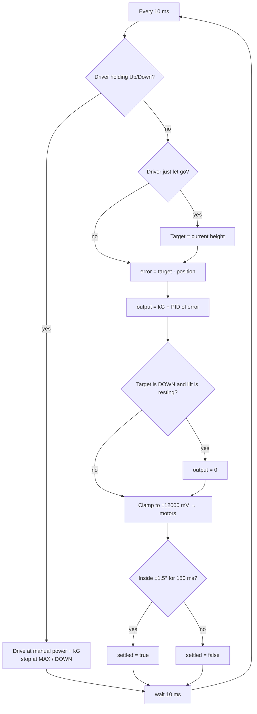
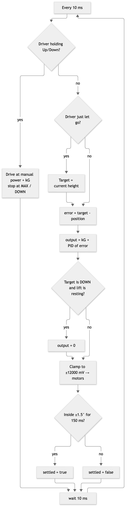

# Program | Lift PID Controller

**Files:** `include/subsystems/lift.hpp`, `src/subsystems/lift.cpp`, `include/config.hpp` (gains and presets)

## Purpose
- The DR6-4B has to stop at exact heights: the intake handoff, carry, the low goal and the high goal.
- With plain motor power the lift overshoots going up, sags under load and drifts down over time.
- A PID loop measures how far the arm is from the target every 10 ms and corrects it. A gravity term (kG) holds up the lift's weight, so the PID only has to correct the error.

## How it works
- **Sensor:** motor encoders ÷ 3 (the 12T → 36T gear ratio) give the lift-arm angle. If a rotation sensor is added on the lift pivot, set `LIFT_ROTATION_PORT` and the code uses it instead.
- **P** pushes harder the further the arm is from the target.
- **D** brakes as the arm closes in fast, which stops overshoot.
- **I** only builds up within 5° of the target (windup clamp), and it resets when the error changes sign. It fixes a lift that stalls just short.
- **kG** is a constant voltage that holds the lift still against gravity.
- **Output limit:** ±12000 mV. **Top stop:** it will never drive past `MAX`.
- **Settled:** the arm must stay within ±1.5° for 150 ms. The scoring sequence waits on this before it drops a pin.
- **Manual override:** holding Up or Down drives the lift directly. On release, the current height becomes the new target, so the lift holds where you left it.
- We reused **lemlib::PID** for P, I and D, since it already has the windup range and sign-flip reset. The lift-only parts (kG, limits, settle, override) are in our `Lift` class.

## Flowchart



## Key code
```cpp
void Lift::update() {
    const double position = getPosition();
    // ... manual override handled first ...
    const float error = static_cast<float>(target_ - position);
    float output = pid_.update(error) + config::LIFT_KG;          // PID + gravity feedforward
    if (target_ <= DOWN && position <= DOWN + 1.0) output = 0;     // resting on the bottom stop
    output = std::clamp(output, -LIFT_MAX_MV, LIFT_MAX_MV);        // output limit
    motors_.move_voltage(static_cast<int>(output));
    settled_ = settle_.update(error);                              // ±1.5° for 150 ms
}
```

## Tuning procedure
1. **Presets:** lower the lift fully and restart the program so it zeroes. Raise it by hand (or with Up/Down) to each spot and read the angle on the brain screen. Enter the values in `config::lift_preset`.
2. **kG:** set kP = kI = kD = 0. Raise kG until the lift holds still at CARRY without drifting either way, then record it.
3. **kP:** raise kP until the lift reaches SCORE_HIGH quickly and just starts to overshoot.
4. **kD:** raise kD until the overshoot is gone.
5. **kI:** only if the lift stops short of the target by more than 1.5°. Add a small kI.
6. Re-run the test table below after each change.

## Test | Lift PID (blank; fill in on the robot)
**Procedure:** start at DOWN and press R1 to go to SCORE_HIGH. Measure from the button press until the screen says SETTLED. Do 5 trials empty and 5 holding a pin.

| Trial | Load | kP | kD | kG | Time to settle (s) | Overshoot (°) | Final error (°) | Held for 10 s? (Y/N) |
|---|---|---|---|---|---|---|---|---|
| 1 | empty | | | | | | | |
| 2 | empty | | | | | | | |
| 3 | empty | | | | | | | |
| 4 | empty | | | | | | | |
| 5 | empty | | | | | | | |
| 6 | pin | | | | | | | |
| 7 | pin | | | | | | | |
| 8 | pin | | | | | | | |
| 9 | pin | | | | | | | |
| 10 | pin | | | | | | | |
| **Avg** | | | | | | | | |

## Photos and recordings to take
- A side video of one move from DOWN to SCORE_HIGH before tuning, showing the overshoot, and one after tuning.
- A photo of the brain screen showing "Lift xx / xx deg SETTLED".
- A photo of the 12T → 36T lift gears, which explains the ÷ 3 in the code.
