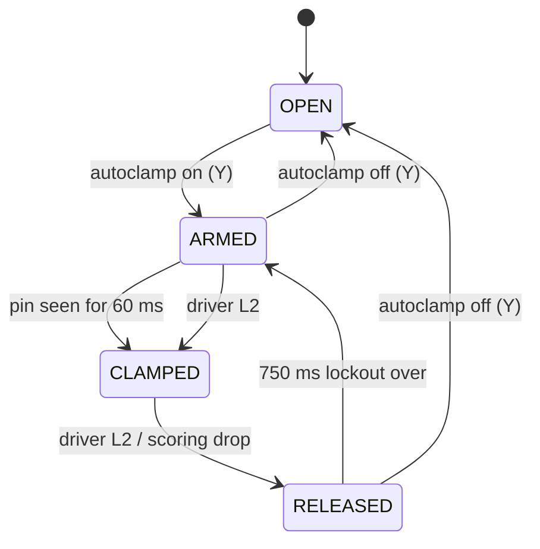
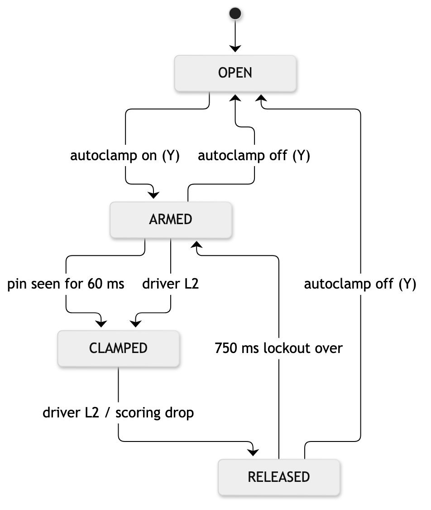

# Program | Claw Autoclamp

**Files:** `include/subsystems/claw.hpp`, `src/subsystems/claw.cpp`, `include/config.hpp`

## Purpose
- Grabbing a pin takes two things at once: lining the claw up, and pressing clamp at the right moment. A late press loses time, and an early press grabs air.
- A distance sensor between the jaws sees the pin arrive and fires the pneumatic cylinder by itself, so the driver only has to line the claw up.

## How it works: a four-state machine
| State | Jaws | What happens |
|---|---|---|
| OPEN | open | Autoclamp is off. The driver has full manual control. |
| ARMED | open | The robot watches the sensor. If a pin stays within `CLAW_DETECT_MM` for `CLAW_DETECT_DEBOUNCE_MS` (60 ms), it goes to CLAMPED. |
| CLAMPED | closed | Holding a pin. Only the driver or the scoring sequence can open it. |
| RELEASED | open | The pin was just let go. The sensor is ignored for `CLAW_RELEASE_LOCKOUT_MS` (750 ms) so the claw doesn't grab the same pin again, then it goes back to ARMED. |

- **Debounce:** one noisy sensor reading won't fire the claw. The pin has to be seen continuously.
- **Lockout:** after dropping a pin on a goal, the claw would otherwise see that pin and clamp straight back onto it.
- **Driver override:** L2 clamps or releases at any time, and Y turns autoclamp on or off.

## Flowchart



## Key code
```cpp
case State::ARMED:
    if (seesPin()) {
        if (seenSince_ == 0) seenSince_ = now;                          // first sighting
        if (now - seenSince_ >= CLAW_DETECT_DEBOUNCE_MS) clamp();       // seen long enough → close
    } else {
        seenSince_ = 0;                                                 // lost it → start over
    }
    break;
case State::RELEASED:
    if (now - releasedAt_ >= CLAW_RELEASE_LOCKOUT_MS) state_ = State::ARMED;  // lockout over
    break;
```

## Tuning procedure
1. Mount the distance sensor so it looks straight between the jaws. Set `CLAW_DISTANCE_PORT`.
2. Put a pin fully in the jaws and read the distance. Pull it back to the edge of the jaws and read it again. Set `CLAW_DETECT_MM` just above the fully-in reading.
3. Debounce: start at 60 ms. Raise it if the claw fires on pins passing by, and lower it if it feels slow.
4. Lockout: drop a pin with the robot still. Raise the lockout until the claw no longer re-grabs it.

## Test | Autoclamp vs Manual Clamp (blank; fill in on the robot)
**Procedure:** a pin is placed in the same spot each time. The driver drives in and grabs it. Do 10 trials with manual L2 and 10 with autoclamp. Time from the claw reaching the pin to the jaws closed (from slow-motion video).

| Trial | Mode | Grabbed? (Y/N) | Time pin→closed (s) | Off-centre distance (in) | Air grab / false clamp? |
|---|---|---|---|---|---|
| 1 | manual | | | | |
| 2 | manual | | | | |
| 3 | manual | | | | |
| 4 | manual | | | | |
| 5 | manual | | | | |
| 6 | manual | | | | |
| 7 | manual | | | | |
| 8 | manual | | | | |
| 9 | manual | | | | |
| 10 | manual | | | | |
| 11 | auto | | | | |
| 12 | auto | | | | |
| 13 | auto | | | | |
| 14 | auto | | | | |
| 15 | auto | | | | |
| 16 | auto | | | | |
| 17 | auto | | | | |
| 18 | auto | | | | |
| 19 | auto | | | | |
| 20 | auto | | | | |
| **Success % / avg** | | | | | |

## Photos and recordings to take
- A photo of the distance sensor mount between the jaws, with a callout label.
- A slow-motion video of the autoclamp firing as a pin enters.
- A video of a pin drop followed by no re-grab, which shows the lockout working.
