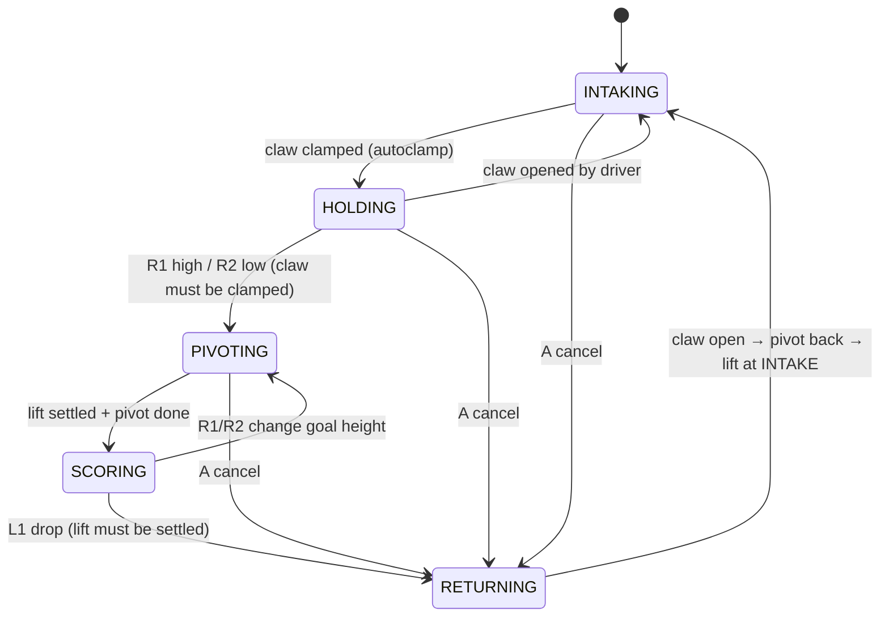
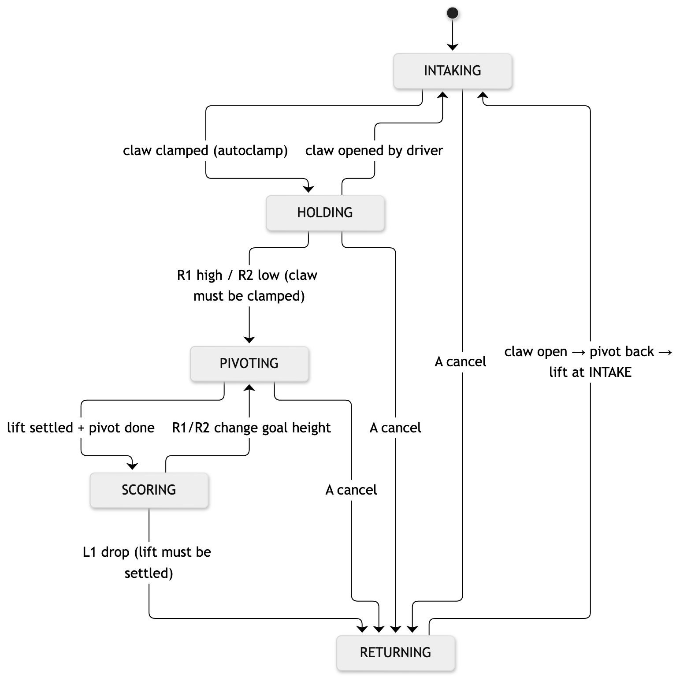

# Program | Intake → Scoring Pivot (State Machine)

**Files:** `include/subsystems/scoring.hpp`, `src/subsystems/scoring.cpp`

## Purpose
- Going from "pin picked up" to "pin on the goal" moves four things: the intake rollers, the claw, the lift and the pivot.
- Done by hand in the wrong order, the robot can swing an empty claw, open the claw mid-swing, or hit the intake with the lift.
- One state machine owns the order. The driver only presses score height (R1/R2) and drop (L1).

> **Assumption (TODO(team): confirm):** the notebook doesn't describe a separate claw pivot or wrist yet, so for now the "pivot" is the DR6-4B moving from the intake handoff to the score height. If a flip cylinder is added, set `PIVOT_PISTON_PORT` and the same sequence drives it. The pivot steps are skipped while there's no port.

## How it works
| State | Lift | Claw | Intake | Leaves when |
|---|---|---|---|---|
| INTAKING | INTAKE | ARMED (autoclamp) | IN | the claw clamps a pin → HOLDING |
| HOLDING | CARRY | CLAMPED | stop | the driver presses R1/R2 → PIVOTING |
| PIVOTING | score height | CLAMPED | stop | the lift settles (and the pivot finishes) → SCORING |
| SCORING | score height | CLAMPED | stop | the driver presses L1 → RETURNING |
| RETURNING | → INTAKE | RELEASED | stop | the lift settles at INTAKE → INTAKING |

**Interlocks (safety rules):**
1. There's no pivot unless the claw is **CLAMPED**, so an empty claw never swings.
2. The pivot only flips once the lift is **above CARRY**, so it clears the intake and the drivetrain.
3. The claw only opens once the lift is **SETTLED** at the goal, so the pin lands on the goal and isn't thrown.
4. On return, the pivot flips back **before** the lift drops below CARRY.

The **A** button cancels from any state: it opens the claw and returns to intaking.

## Flowchart



## Key code
```cpp
void Scoring::requestScore(double liftDegrees) {
    if (state_ != State::HOLDING && state_ != State::SCORING) return;  // interlock 1
    if (!claw_.isClamped()) return;
    scoreTarget_ = liftDegrees;
    enter(State::PIVOTING);
}

case State::PIVOTING:
    if (lift_.getPosition() >= preset::CARRY) setPivot(true);           // interlock 2
    if (lift_.isSettled() && pivotDone) enter(State::SCORING);
    break;

void Scoring::release() {
    if (state_ == State::SCORING && lift_.isSettled()) enter(State::RETURNING);  // interlock 3
}
```

## Tuning procedure
1. Tune the lift PID first (Program | Lift PID Controller). This sequence depends on "settled" being reliable.
2. Set CARRY just high enough that a held pin clears the field and the intake.
3. With a pivot cylinder fitted, film the pivot and set `PIVOT_TIME_MS` to the time it takes to finish moving.
4. Set `CLAW_OPEN_TIME_MS` to the time the jaws need to open fully before the lift moves away.

## Test | Full Scoring Cycle (blank; fill in on the robot)
**Procedure:** place a pin 24" in front of the robot. Time from start → pin picked up → pin on the high goal → back at INTAKE. Do 5 trials with the old fully-manual controls and 5 with the state machine.

| Trial | Controls | Pickup time (s) | Pickup → scored (s) | Scored → ready again (s) | Total cycle (s) | Pin scored? (Y/N) | Driver mistakes |
|---|---|---|---|---|---|---|---|
| 1 | manual | | | | | | |
| 2 | manual | | | | | | |
| 3 | manual | | | | | | |
| 4 | manual | | | | | | |
| 5 | manual | | | | | | |
| 6 | state machine | | | | | | |
| 7 | state machine | | | | | | |
| 8 | state machine | | | | | | |
| 9 | state machine | | | | | | |
| 10 | state machine | | | | | | |
| **Avg** | | | | | | | |

## Photos and recordings to take
- A full-cycle video with the brain screen visible (it shows the state name: INTAKING → HOLDING → PIVOTING → SCORING → RETURNING).
- Photos of the robot in each of the five states, side by side for a before/after page.
- If there's a pivot cylinder, a close-up of it in both positions.
